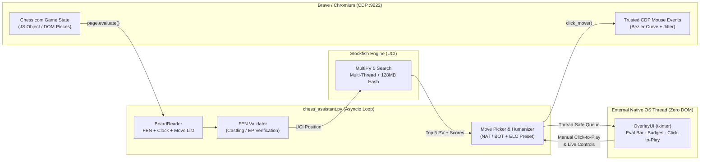

<div align="center">

# ♟️ Chess.com Assistant `v1.1.0`

**Real-time Stockfish HUD & adaptive humanization engine for Chess.com over Chrome DevTools Protocol (CDP).**  
Reads live board state without screen capture, analyzes top 5 candidate lines with multi-threaded Stockfish, and renders an external native `tkinter` HUD with **0% in-page DOM footprint**.

[](https://github.com/aplatogg/chess-assistant/releases)
[](https://www.python.org/)
[](https://stockfishchess.org/)
[](https://playwright.dev/python/)
[-94e2d5?style=flat-square)](#architecture--zero-dom-design)
[](https://github.com/aplatogg/chess-assistant/actions/workflows/ci.yml)
[](LICENSE)

[**Features**](#key-features) · [**HUD Preview**](#hud-overview--controls) · [**Architecture**](#architecture--zero-dom-design) · [**Humanization Engine**](#adaptive-humanization--elo-presets) · [**Quickstart**](#quickstart) · [**CLI Reference**](#cli-reference)

</div>

---

## Key Features

| Module | Capability |
| :--- | :--- |
| **Zero-DOM Native HUD** | Renders in an external, always-on-top native Windows `tkinter` window (Catppuccin Mocha palette). Injects **zero** HTML/CSS/SVG elements into the Chess.com page DOM. |
| **Live FEN Extraction** | Reads full FEN strings directly from the Chess.com game state (`castling rights KQkq`, `en passant squares`, active turn) with automatic DOM piece fallback and `python-chess` legality sanitization. |
| **Click-to-Play Top 5** | Every row in the Top 5 moves list is interactive — click any candidate line (`#1`–`#5`) in the HUD to immediately execute it on the board, even while `AUTO: OFF`. |
| **Move Quality Badges** | Real-time centipawn gap classification next to each candidate move: `[BEST]` (Green), `[GOOD]` (Blue, `≤ 0.30`), `[OK]` (Yellow, `≤ 0.90`), and `[RISK]` (Red, `> 0.90` or missed forced mate). |
| **Adaptive Humanization** | Position-aware think delay (`NAT` mode) that accelerates on obvious recaptures/forced replies (`0.75–1.6s`), snaps `M1` mates (`0.55–1.15s`), pauses on complex tactical choices (`2.5–4.8s`), and speeds up under clock pressure. |
| **Live ELO Presets** | Cycle `ELO: MAX → 2200 → 1800 → 1500` directly from the HUD footer to dynamically tune Stockfish `UCI_LimitStrength` / `UCI_Elo` / `Skill Level` and move variety. |
| **Multi-Thread Turbo** | Automatically configures Stockfish with `Threads: min(4, cpu_count // 2)` and `128 MB Hash` for fast `MultiPV 5` depth convergence. |
| **Full Endgame & Promo** | Supports all 4 promotion piece types (`=Q`, `=N` knight underpromotion, `=R`, `=B`) and tracks positions down to 2-piece endgames across Live, Daily, Puzzles, Practice, and Analysis boards. |

---

## HUD Overview & Controls

<table>
<tr>
<td width="380" align="center">
  
  <br />
  <sub><b>Chess.com HUD v1.1.0</b> — Queen's Gambit Declined analysis</sub>
</td>
<td valign="top">

### Interactive HUD Controls

| Control | Function |
| :--- | :--- |
| **`100% / 85% / 70%`** | Cycles window transparency (`-alpha`) so the board remains visible underneath. |
| **`▬ / ▣`** | Toggles **Compact Mini Mode** (`360×148`), collapsing the move list and PV into a slim status bar. |
| **`🟢 GILIRAN LU`** | Live turn indicator & real-time `0.1s` countdown banner (`⚡ AUTO: Kuda b1->c3 (1.4s…)`) during auto-play delay. |
| **`NAT / BOT`** | Switches between **Adaptive Human (`NAT`)** and **Engine Speed (`BOT`)** execution profiles. |
| **`AUTO: ON / OFF`** | Toggles hands-free automatic move execution on your turn. |
| **`Top Move Rows #1–5`** | **Click-to-Play**: clicking any row executes that specific move on the board via Bezier mouse curves. |
| **`Depth (5–30)`** | Live Stockfish search depth spinner (automatically scales down when clock `< 60s`). |
| **`ELO: MAX / 2200…`** | Cycles engine strength and human move selection accuracy in real time. |

</td>
</tr>
</table>

---

## Architecture & Zero-DOM Design

Unlike browser extensions that inject visible `<div id="overlay">` or `<svg>` arrow layers directly into the Chess.com document tree, **Chess.com Assistant** runs its UI in an isolated native OS process thread and communicates with the browser strictly over local CDP.



---

## Adaptive Humanization & ELO Presets

### 1. Position-Aware Think Timing (`NAT` Mode)

Rather than using a static random delay on every move, `ChessAssistant._human_think_time()` adapts to board complexity and remaining clock:

| Situation | Condition | Delay Range | Behavior |
| :--- | :--- | :---: | :--- |
| **Opening Theory** | Move number `< 10` | `1.00s – 2.20s` | Plays top book/engine line confidently |
| **Mate-in-1 Snap** | Forced `M1` on board | `0.55s – 1.15s` | Instant execution of 1-move checkmate |
| **Forced Mate (`M2+`)** | Forced mate sequence found | `1.00s – 2.10s` | Locks 100% onto fastest mate (`moves[0]`) |
| **Obvious / Forced Move** | Eval gap `#1 vs #2 ≥ 2.00` pawns | `0.75s – 1.60s` | Quick recapture or single non-losing reply |
| **Standard Middlegame** | Normal eval separation | `1.50s – 3.30s` | Balanced human rhythm |
| **Complex Tactical Choice** | Eval gap `#1 vs #2 < 0.35` pawns | `2.50s – 4.80s` | Pauses longer on critical branching positions |
| **Low Clock Pressure** | Clock `< 25s` remaining | `0.65s – 1.45s` | Depth scales to `12`, faster mouse cadence |
| **Bullet / Scramble** | Clock `< 10s` remaining | `0.35s – 0.95s` | Depth scales to `8`, rapid survival mode |

### 2. Live ELO & Move Distribution Presets

| Preset | Stockfish UCI Configuration | Top-1 Move Rate | Close 2nd/3rd Alt Rate | Forced Mate Lock |
| :---: | :--- | :---: | :---: | :---: |
| **`ELO: MAX`** | `UCI_LimitStrength=False`, `Skill Level=20` | `~80%` (`NAT`) / `~93%` (`BOT`) | `20%` (only if gap `< 1.5`) | **Always 100% `#1`** |
| **`ELO: 2200`** | `UCI_LimitStrength=True`, `UCI_Elo=2200` | `~80%` | `20%` (only if gap `< 1.5`) | **Always 100% `#1`** |
| **`ELO: 1800`** | `UCI_LimitStrength=True`, `UCI_Elo=1800` | `~68%` | `32%` (only if gap `< 1.5`) | **Always 100% `#1`** |
| **`ELO: 1500`** | `UCI_LimitStrength=True`, `UCI_Elo=1500` | `~55%` | `45%` (only if gap `< 1.5`) | **Always 100% `#1`** |

---

## Quickstart

### Prerequisites

- **Windows 10 / 11** (`tkinter` always-on-top HUD and default browser paths are tuned for Windows)
- **Python 3.10+**
- **[Stockfish](https://stockfishchess.org/download/)** — place `stockfish.exe` in the project root, `stockfish\stockfish.exe`, on your `PATH`, or pass `--stockfish PATH`
- **Brave Browser** (recommended) or **Firefox**

### 1. Clone & Install Dependencies

```powershell
git clone https://github.com/aplatogg/chess-assistant.git
cd chess-assistant

python -m venv .venv
.venv\Scripts\activate
pip install -r requirements.txt
playwright install chromium
```

### 2. Start Brave with Remote Debugging (`CDP`)

Launch Brave with a dedicated profile directory so it runs alongside your normal browser session without conflict:

```powershell
& "C:\Program Files\BraveSoftware\Brave-Browser\Application\brave.exe" `
  --remote-debugging-port=9222 `
  --user-data-dir="$env:USERPROFILE\.chess-assistant\brave-profile"
```

Log in to [Chess.com](https://www.chess.com/play/online) inside that Brave window and open any game, puzzle, or bot match.

### 3. Launch the Assistant

```powershell
# Connect to Brave on port 9222 (manual HUD + Click-to-Play enabled)
python chess_assistant.py --browser brave

# Start with Auto-Play enabled immediately
python chess_assistant.py --browser brave --auto-play

# Custom Stockfish search depth (5-30) and explicit engine binary path
python chess_assistant.py --browser brave --depth 20 --stockfish "C:\tools\stockfish.exe"

# Launch a dedicated browser window automatically instead of attaching to CDP
python chess_assistant.py --launch
```

---

## CLI Reference

| Flag | Default | Description |
| :--- | :---: | :--- |
| `--browser {brave,firefox}` | `brave` | Target browser engine (`brave` attaches over CDP or launches; `firefox` launches Playwright Firefox). |
| `--launch` | `False` | Launch a dedicated browser instance automatically instead of connecting to an existing CDP port. |
| `--port 1-65535` | `9222` | Local Chrome DevTools Protocol (CDP) debugging port. |
| `--depth 5-30` | `18` | Base Stockfish search depth (dynamically scales down when clock `< 60s`). |
| `--stockfish PATH` | `auto` | Explicit path to `stockfish.exe`. |
| `--auto-play` | `False` | Start with `AUTO: ON` enabled immediately. |
| `--debug` | `False` | Enable verbose debug logging to console and rotating log file. |
| `--version` | — | Display version (`1.1.0`) and exit. |

### Environment Variables & Logs

| Variable | Default | Purpose |
| :--- | :--- | :--- |
| `CHESS_ASSISTANT_DATA_DIR` | `%USERPROFILE%\.chess-assistant` | Directory for rotating logs (`chess_assistant.log`, 1 MB × 3 backups) and the dedicated `--launch` profile. |
| `CHESS_ASSISTANT_BRAVE` | `C:\Program Files\BraveSoftware\Brave-Browser\Application\brave.exe` | Override Brave executable path. |
| `CHESS_ASSISTANT_FIREFOX` | `C:\Program Files\Mozilla Firefox\firefox.exe` | Override Firefox executable path. |

---

## Development & Testing

```powershell
pip install -r requirements-dev.txt

# Run linter
ruff check .

# Run unit test suite (16 tests)
python -m pytest -q
```

---

## Disclaimer

This software is built for **educational research, UI automation study, and offline/unrated engine testing**.  
Using external engine assistance during rated games on Chess.com violates their [Fair Play Policy & Terms of Service](https://www.chess.com/legal/user-agreement). Use responsibly in unrated games, bot matches, puzzles, or analysis boards.

---

<div align="center">

**[MIT License](LICENSE)** · Crafted by **[@aplatogg](https://github.com/aplatogg)**

</div>
