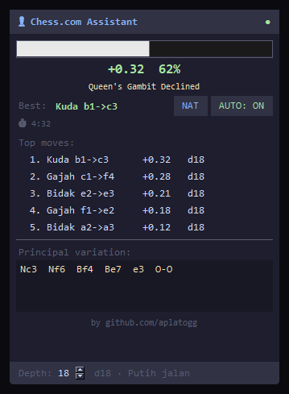

# ♟ Chess.com Assistant

A real-time Chess.com assistant powered by **Stockfish** and **Playwright**.  
Reads the live board state via browser CDP, analyzes with Stockfish, and shows a floating overlay with top moves, evaluation bar, and principal variation — with optional auto-play.


---

## Features

- **Live board reading** — grabs FEN directly from the Chess.com game object (no screen capture)
- **Stockfish analysis** — top 5 moves with scores, depth, and full principal variation
- **Floating overlay UI** — always-on-top panel with eval bar, win%, opening name, clock
- **Auto-play** — two modes:
  - `NAT` — human-like timing (2–5s think time, ~80% best move rate)
  - `BOT` — engine-like speed (~0.2–0.9s, ~93% best move rate)
- **Opening book** — recognizes 60+ openings and displays the name live
- **Time management** — auto-reduces analysis depth when clock is low
- **Anti-throttle** — injects silent Web Audio to prevent background-tab slowdowns
- **Brave / Firefox support** — connects to existing browser via CDP or launches fresh

---

## Requirements

- **Windows 10 or 11** (the launcher, CDP setup and `tkinter` overlay are Windows-specific)
- Python 3.10+
- [Stockfish](https://stockfishchess.org/download/) - place `stockfish.exe` next to the script, or pass `--stockfish PATH`
- Brave Browser (recommended) or Firefox

---

## Installation

```bash
# 1. Clone the repo
git clone https://github.com/aplatogg/chess-assistant.git
cd chess-assistant

# 2. Install Python dependencies in a virtual environment
python -m venv .venv
.venv\Scripts\activate
pip install -r requirements.txt

# 3. Install the Playwright browser driver
playwright install chromium
# Only if you use the Firefox launcher:
# playwright install firefox

# 4. Download Stockfish
# https://stockfishchess.org/download/
# Place stockfish.exe next to chess_assistant.py, or use --stockfish PATH.
```

---

## Usage

### Step 1 — Launch Brave with remote debugging

Use a dedicated profile so this does not touch your normal Brave session:

```powershell
& "C:\Program Files\BraveSoftware\Brave-Browser\Application\brave.exe" `
  --remote-debugging-port=9222 `
  --user-data-dir="$env:USERPROFILE\.chess-assistant\brave-profile"
```

Log in to Chess.com once in that window. If Brave is already running, the
command above opens a separate profile; the assistant never kills your browser.

### Step 2 — Open Chess.com and start a game

Go to [chess.com/play/online](https://www.chess.com/play/online) and start a game.

### Step 3 — Run the assistant

```bash
# Connect to running Brave (recommended)
python chess_assistant.py --browser brave

# With auto-play enabled from the start
python chess_assistant.py --browser brave --auto-play

# Custom analysis depth (default: 18, range 5-30)
python chess_assistant.py --depth 20

# Explicit Stockfish path
python chess_assistant.py --stockfish C:\tools\stockfish.exe

# Verbose logging
python chess_assistant.py --debug

# Launch a new browser window instead of connecting
python chess_assistant.py --launch
```

---

## Overlay UI

<p align="center">
  
</p>

<p align="center"><sub>Example analysis of a Queen's Gambit Declined position.</sub></p>

| Button | Action |
|--------|--------|
| `AUTO: ON/OFF` | Toggle auto-play |
| `NAT / BOT` | Switch between human-like and engine-like play style |
| `Depth spinner` | Adjust Stockfish analysis depth (5–30) |

---

## Auto-play Modes

| Mode | Think time | Best move % | Use case |
|------|-----------|-------------|---------|
| **NAT** | 2–5 seconds | ~80% | Looks human, avoids detection |
| **BOT** | 0.2–0.9 seconds | ~93% | Fastest, engine-like |

Both modes automatically play faster when clock is below 30 seconds.

---

## Stockfish Path

The script looks for Stockfish in this order:

1. `--stockfish PATH`
2. `stockfish.exe` next to `chess_assistant.py`
3. `stockfish\stockfish.exe` next to the script
4. `stockfish.exe` in the current working directory
5. `stockfish` on `PATH`

---

## CLI Arguments

| Argument | Default | Description |
|----------|---------|-------------|
| `--browser` | `brave` | `brave` or `firefox` |
| `--launch` | off | Open a dedicated browser profile instead of connecting to an existing CDP browser |
| `--port` | `9222` | CDP remote debugging port (1-65535) |
| `--depth` | `18` | Stockfish analysis depth (5-30) |
| `--stockfish` | auto | Path to the Stockfish executable |
| `--debug` | off | Verbose logging |
| `--version` | | Print the version and exit |
| `--auto-play` | off | Enable auto-play on startup |

`--browser firefox` uses Playwright Firefox (not CDP): run
`playwright install firefox` first. It opens a fresh Playwright browser, not
your daily Firefox profile.

### Data and logs

The assistant writes a rotating log to `%USERPROFILE%\.chess-assistant\` and
keeps the dedicated Brave profile there. Override the location with
`CHESS_ASSISTANT_DATA_DIR`. The log rotates at 1 MB with three backups.
`CHESS_ASSISTANT_BRAVE` and `CHESS_ASSISTANT_FIREFOX` override the browser
executable paths.

---

## Development

```bash
pip install -r requirements-dev.txt
ruff check .
python -m pytest -q
```

---

## How It Works

1. **Board reading** — Connects to Brave/Chrome via Chrome DevTools Protocol (CDP). Reads the FEN position directly from the Chess.com JavaScript game object (`board.game.getFEN()`), falling back to DOM piece parsing if the API is unavailable.

2. **Engine analysis** — Sends the FEN to Stockfish via UCI protocol using `python-chess`. Requests `MultiPV 5` (top 5 moves) with configurable depth.

3. **Overlay** — A `tkinter` window rendered on a separate thread, always on top. Updates every ~0.7 seconds via a thread-safe queue.

4. **Auto-play** — On our turn, waits for the configured think delay, verifies the position hasn't changed (opponent didn't premove), then simulates mouse clicks on the board squares using CDP mouse events with a Bezier curve movement path.

---

## Disclaimer

This tool is for **educational and research purposes** only.  
Using third-party assistance tools during rated Chess.com games violates their [Terms of Service](https://www.chess.com/legal/user-agreement).  
Use only in unrated games, puzzles, or analysis mode.

---

## License

MIT License — see [LICENSE](LICENSE) for details.

---

<div align="center">
  Made by <a href="https://github.com/aplatogg">@aplatogg</a>
</div>
